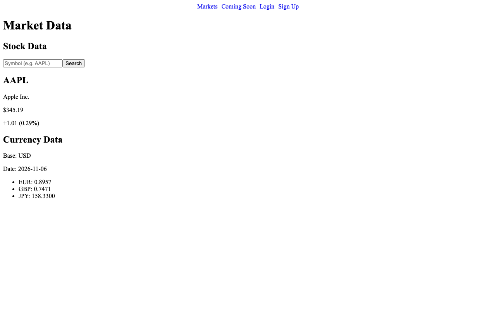

# Market Data



A market-data foundation for a paper-trading simulator. The current build provides live stock quotes and FX rates; authentication, portfolios, and trading are schema-only for now.

## Requirements

- [Nix](https://nixos.org/) with [devenv](https://devenv.sh/) for the provisioned path.
- Node 24 and npm 11 if you run without devenv.

## Quick start

```sh
devenv shell     # installs Node 24 + PostgreSQL and project dependencies
devenv up        # Postgres (see $DATABASE_URL), API :8080, Vite :3000
```

Open `http://localhost:3000`.

## Without devenv

```sh
npm ci
npm run dev:api   # terminal 1
npm run dev       # terminal 2
```

Postgres is not needed for the quote and FX endpoints.

## Production build

```sh
npm run build
npm start         # http://localhost:8080
```

## Database

```sh
psql -U marketdata -d marketdata_dev -c '\dt'   # inside devenv shell
```

The schema is applied on the first `devenv up` and lives in `schema/schema.sql`. The full connection URL is exported as `DATABASE_URL`. To reload the schema, reset the local dev database:

```sh
devenv processes down && rm -rf .devenv/state/postgres
```

## Commands

| Command           | Purpose                                              |
| ----------------- | ---------------------------------------------------- |
| `npm run dev`     | Vite dev server on :3000, proxying `/v1` to :8080    |
| `npm run dev:api` | API server with watch mode on :8080                  |
| `npm run build`   | Typecheck, then build the client into `static/`      |
| `npm start`       | Serve the API and built client on :8080              |
| `npm run typecheck` | TypeScript check without emitting                  |
| `npm test`        | Run the Vitest suite                                  |

## Data sources

- **FX rates:** [Frankfurter](https://frankfurter.dev/), keyless.
- **Stock quotes:** Yahoo Finance chart JSON, keyless and unofficial.

Upstream failures return `502` JSON rather than crashing the server.
